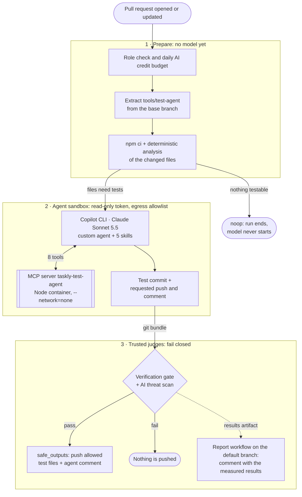
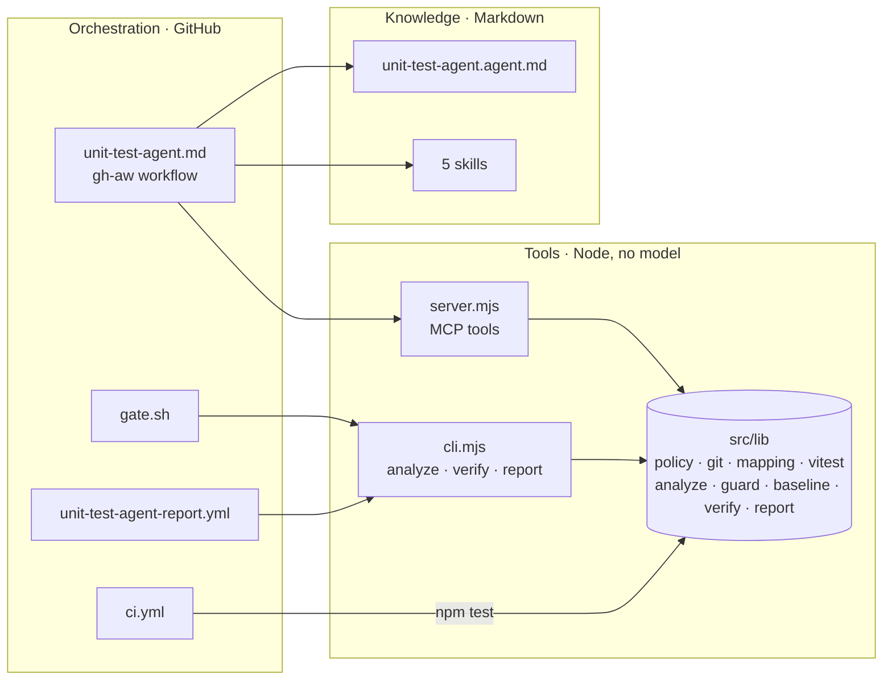
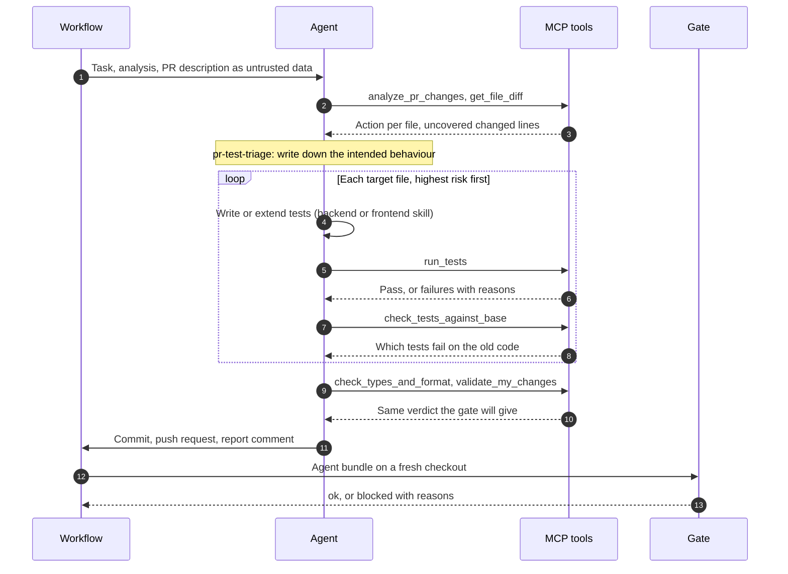
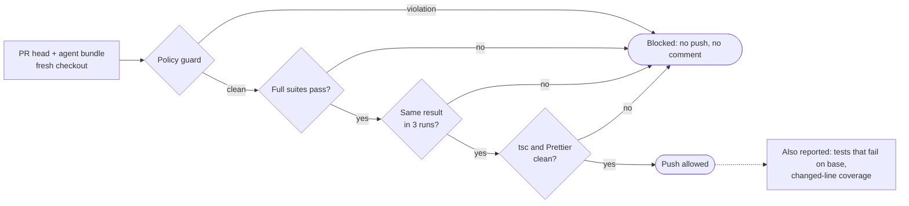
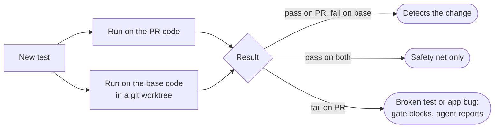
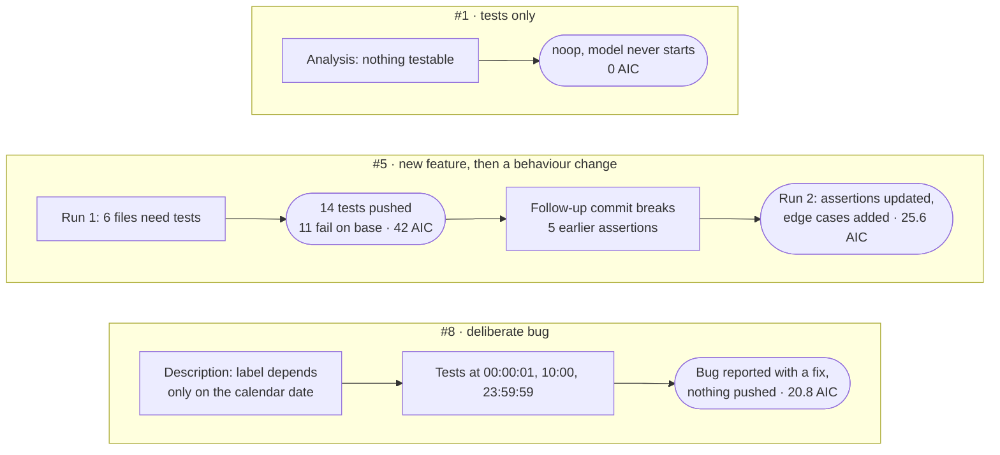

# Unit test agent: solution notes

A custom agent with reusable skills that writes and updates unit tests for the Taskly frontend and backend, plus a GitHub pull request workflow that runs it automatically, verifies its work independently, and reports on the pull request.

## At a glance

The model proposes, deterministic code decides. One pull request passes through three trust zones:



| Zone | Runs | Trusts |
| --- | --- | --- |
| 1 · Prepare | Workflow steps and the base branch's `tools/test-agent` | Nothing from the PR except the code it analyzes |
| 2 · Agent sandbox | The model, its skills and MCP tools | Nothing: every output is only a request |
| 3 · Trusted judges | Gate, gh-aw threat scan, safe outputs, report workflow | Only what it re-measures itself |

## Where things live

| Path | What it is |
| --- | --- |
| `.github/agents/unit-test-agent.agent.md` | The custom agent: role, hard rules, tools, process |
| `.github/skills/pr-test-triage/` | Decide create / update / skip per changed file, with reasons |
| `.github/skills/backend-unit-tests/` | Backend conventions: flat `tests/`, supertest, Prisma spies, lifespan and config patterns |
| `.github/skills/frontend-unit-tests/` | Frontend conventions: colocated tests, design-system doubles, TanStack Query hooks, timers |
| `.github/skills/test-verification/` | The verify loop: run, fix tests (never code), prove change detection, coverage, policy check |
| `.github/skills/pr-test-report/` | The PR comment template |
| `tools/test-agent/src/server.mjs` | MCP server exposing the agent's tools |
| `tools/test-agent/src/lib/` | Shared deterministic library: git range, file policy, test mapping, Vitest runner, coverage, base check, guard, report |
| `tools/test-agent/src/cli.mjs` | `analyze` / `verify` / `report` entry points used by the workflow |
| `tools/test-agent/scripts/gate.sh` | Verification gate run in the detection job |
| `.github/workflows/unit-test-agent.md` | The gh-aw workflow (source); `.lock.yml` is the compiled Actions workflow |
| `.github/workflows/unit-test-agent-report.yml` | Publishes the gate's results on the PR |
| `.github/workflows/ci.yml` | Plain CI: typecheck, tests with coverage, tooling tests |
| `.claude/`, `.mcp.json` | The same agent, skills and MCP server wired for local use in Claude Code |



The agent, the gate and the report all call the same library, so the agent sees exactly the numbers CI checks later.

### Inside one agent run



## Main technical decisions

**GitHub Agentic Workflows (gh-aw) with the Copilot engine.** The task requires everything to run on GitHub, and gh-aw provides the security architecture an agent on pull requests needs: the agent job has a read-only token, egress goes through a domain allowlist, and every write (push, comment) is a typed "safe output" applied by a separate job after a threat scan. The workflow is Markdown with frontmatter, compiled to a normal Actions file. The agent and skill files use the standard formats, so the same definitions also run in Claude Code locally (`.claude/` links) and could run on gh-aw's Claude engine by changing `engine.id`.

**Deterministic tools via MCP, judgment by the model.** Everything that has a correct answer is code, not prompt: which files changed, which are testable, which tests cover a module (import graph, ignoring `vi.mock` targets), which changed lines are uncovered, whether a test detects the change. The model gets these as MCP tools and spends its effort on deciding what to test and writing good tests. The same library powers the workflow's pre-analysis and the gate, so the agent sees exactly the numbers CI checks later.

**Agent proposes, deterministic code disposes.** The agent's own claims are never trusted:
- The verification gate rebuilds the result from a fresh checkout plus the agent's git bundle and re-runs everything.
- It runs in gh-aw's detection job with `continue-on-error: false`, so a failure blocks the push and the comment.
- The PR comment with numbers comes from the gate's JSON, rendered by trusted code on the default branch, not from the model.



**"Does this test detect the change?"** Coverage alone rewards tests that execute code without checking it. For each agent-written test file, the gate also runs it against the base branch's code in a temporary worktree. Tests that pass on the PR but fail on the base demonstrably exercise the new behaviour. This is reported per project, and the skills tell the agent to strengthen assertions when tests for changed behaviour do not detect it.



**Security layers**

| Risk | Mitigation |
| --- | --- |
| Agent edits application code, configs or workflows | `allowed-files` on the push safe output; the same policy in `validate_my_changes` and the gate; gh-aw protected files |
| Agent-written tests exfiltrate data | Tests only ever execute inside a Node container with `--network=none` (MCP server and gate) |
| PR weakens the agent's own checks | The MCP server and the gate run `tools/test-agent` from the base branch; gh-aw restores `.github/` (agent, skills) from the base branch |
| Prompt injection via PR content | Agent rules treat PR text and code as data; gh-aw AI threat scan; fail-closed detection |
| Weakened or fake tests | Guard blocks `.only`, `.skip`, `.todo`, files without assertions, real network, process spawning and credential reads. It also blocks updates that leave an existing test file with fewer assertions or test cases than when the agent started |
| Markdown or mention injection in the report | Test names, failure messages and paths from PR code are escaped before posting |
| Template injection in workflows | Event data only via `env:`; gh-aw's compiler rejects `${{ }}` in `run:` |
| Supply chain | Actions pinned by SHA; Node image pinned by digest in the gate (the MCP gateway only accepts a tag, so it uses the exact matching tag) |
| Fork PRs | gh-aw blocks fork PRs by default; only users with write access trigger the agent |
| Runaway cost | Pre-analysis skips the model when nothing testable changed; turn, per-run and daily AI credit caps; at most 12 target files per run; concurrency cancels superseded runs |

**Reliability**
- Each agent-written test file is run three times in the gate. Any inconsistent result fails it.
- The agent's push does not re-trigger CI, so the gate applies CI's own checks to its tests: the project typecheck and Prettier.
- The Vitest cache is disabled because the container writes as a different user.
- A test that fails because the application is wrong is reported as a suspected bug rather than "fixed" by editing code.

## Running the PR workflow

Prerequisites:
1. GitHub repository with Actions enabled.
2. Repository secret `COPILOT_GITHUB_TOKEN`: a fine-grained PAT owned by a user with a Copilot plan that allows choosing models (Pro or above), with only the account permission **Copilot Requests: Read**.
3. Default branch contains the tooling and the compiled workflow. After editing `.github/workflows/unit-test-agent.md`, run `gh aw compile` and commit the `.lock.yml`.

Then open or update a pull request that touches `backend/` or `frontend/`. Draft PRs are skipped until ready for review.

Locally (Claude Code): the repository's `.mcp.json` starts the same MCP server, and `.claude/agents` and `.claude/skills` link to the same agent and skills. The deterministic parts also run on their own:

```sh
npm ci --prefix tools/test-agent
node tools/test-agent/src/cli.mjs analyze --base origin/main --coverage --markdown /dev/stdout --out /dev/null
node tools/test-agent/src/cli.mjs verify --base origin/main --agent-base <commit before your test changes>
npm test --prefix tools/test-agent   # the tooling's own tests
```

## Example runs

Three demo pull requests, each run on GitHub with the real workflow. Credit figures are gh-aw's AI Credits for the agent run (1 AIC = $0.01).



### 1. New feature, tests created: [#5](https://github.com/sebafudi/taskly-app-node/pull/5), [first run](https://github.com/sebafudi/taskly-app-node/actions/runs/39614786528)

The PR adds `GET /api/todos/stats`, an "Overdue" filter and a summary line, with no tests.

**Agent decisions:**
- 6 files got tests: `stats.ts` and `TodoSummary.tsx` new; `router.ts`, `utils/todos.ts`, `TodoFilters.tsx` and `TodosPage.tsx` updated.
- 2 files were skipped: the OpenAPI document and type declarations.

**Skills used:** pr-test-triage, backend-unit-tests, frontend-unit-tests, test-verification, pr-test-report.

**Result:** 14 test cases in 6 files, pushed as a test-only commit.
- `check_tests_against_base`: 11 of the 14 fail on the base code. The agent explained the other 3 correctly: on the base branch `/stats` already returns 422, because it is parsed as an invalid `:id`.
- The gate measured every changed line covered: `router.ts` 4/4, `stats.ts` 10/10, `TodoSummary.tsx` 3/3, `utils/todos.ts` 2/2.
- No flaky tests.
- Cost: 42 AIC.

### 2. Behaviour change, existing tests updated: #5, [second run](https://github.com/sebafudi/taskly-app-node/actions/runs/39639817490)

A follow-up commit adds a `dueSoon` count and "due today" to the summary. That breaks 5 of the agent's earlier assertions.

**Agent decisions:**
- It reasoned that the baseline failures came from the intended change ("the code was right, so I updated the assertions").
- It updated `stats.test.ts`, `router.test.ts` and `todos.test.ts`, and added 7-day-horizon, completed-task and month/year-boundary cases.
- It skipped the files whose tests still passed.

**Gate:**
- backend 102/102, frontend 103/103;
- changed-line coverage 100%;
- typecheck and Prettier clean;
- no flaky tests.

Cost: 25.6 AIC.

### 3. Deliberate bug, reported instead of masked: [#8](https://github.com/sebafudi/taskly-app-node/pull/8), [run](https://github.com/sebafudi/taskly-app-node/actions/runs/39641670210)

The PR adds relative due-date labels. Its description says the label "must depend only on the calendar date, not on the time of day", but the code subtracts `Date.now()` from local midnight.
- The agent tested the stated rule at 00:00:01, 10:00 and 23:59:59, saw "1 day overdue" for a task due today, and reported it as a suspected bug with input, expected and actual output, and a suggested fix.
- It kept the failing test out of the patch and pushed nothing.
- Cost: 20.8 AIC.

An earlier run on this PR, before the skills required testing the stated intent, noticed the problem but pinned the clock to midnight. That led to the "never route around a failure" rule in `test-verification` and to passing the sanitized PR description to the agent as its specification.

### Skipping without a model call: [#1](https://github.com/sebafudi/taskly-app-node/pull/1)

The coverage PR changes only tests. The pre-analysis found nothing to test, wrote a `noop`, and the harness ended the run before starting the model (`pre-flight: noop message found in safe-outputs, skipping agent`).

## Coverage work

The missing tests for the existing code were written by agents working only from this repository's agent definition and skills, then reviewed, and merged as a separate PR. Both agents reported where the skills were unclear, and the skills were updated from that feedback.

| Project | Lines before | Lines after | Branches after | Tests |
| --- | --- | --- | --- | --- |
| backend | 33.0% | 97.2% | 97.9% | 48 → 93 |
| frontend | 47.7% | 100% | 99.3% | 18 → 96 |

Remaining gaps: `backend/src/main.ts` (process entry point) and two defensive guards that the UI cannot reach.

## What broke along the way

These all happened on real runs and are fixed. Each one is a lesson for anyone running gh-aw:

| Symptom | Cause | Fix |
| --- | --- | --- |
| Skip step crashed | gh-aw documents `$GH_AW_SAFE_OUTPUTS` for custom steps but does not export it there | Fall back to the runtime's own path |
| MCP gateway refused to start | The gateway schema rejects `image@sha256:` references | Exact version tag; the gate keeps the digest pin |
| "Model not supported" for every premium model | Copilot Student only offers automatic model choice, and gh-aw rewrites `auto` to a fixed model | Copilot Pro and explicit model ids with fallbacks |
| Agent skipped without running | Runs that never reach a model have no usage data and count as the full per-run cap against the 5000/day default | Realistic `max-ai-credits` and `max-daily-ai-credits` |
| Push refused for `backend/tests/router.test.ts` | gh-aw's `**/` needs at least one directory | List top-level test files separately |
| Agent wary of files it never touched | The runtime restores `.github/` and removes `.mcp.json` before the agent starts | `validate_my_changes` reports those separately and they are never staged |

The safety layers worked in each case. The refused push left the agent's tests unpublished, and the agent reported the run as incomplete instead of working around the policy: its attempt to `git reset` was denied.

## Assumptions

- Pull requests come from branches in the same repository by people with write access. That is gh-aw's default trust model.
- Unit tests must not need PostgreSQL or a browser, so the agent mocks Prisma and HTTP and uses jsdom, as the existing tests already do.
- "Unit test" excludes type-only files, stories, styles, barrels, generated code, configuration and the design system, which `vite.config.ts` already excludes from coverage.
- The agent should never change application code. Fixing a bug a test uncovers is a human decision.

## Limitations

- **Fork PRs are not supported.** gh-aw blocks them by default, and pushing to fork branches is not supported.
- **Base-branch sensitivity is approximate.** The worktree reuses the PR's `node_modules` and generated Prisma client, so a PR that changes dependencies or the Prisma schema can skew it.
- **The gate runs agent-written tests inside its own container, which also writes the report file.** A deliberately malicious test could in theory tamper with that file. The path policy is enforced outside test execution, by gh-aw's `allowed-files`.
- **Model access depends on the Copilot plan.** Copilot Student only offers automatic model selection, which gh-aw's harness rewrites to a fixed model.
- **gh-aw quirks found along the way and worked around:**
  - Custom steps don't receive `GH_AW_SAFE_OUTPUTS`.
  - `allowed-files` treats `**/` as "at least one directory".
  - The MCP gateway rejects digest-pinned images.
  - Runs without usage data are counted at the per-run AI credit cap.
- **Pushes made with `GITHUB_TOKEN` don't trigger other workflows,** so plain CI does not re-run on the agent's commit. The gate covers that verification.
- **On later runs the agent can mistake its own earlier tests for the author's.** Both kinds are simply "tests changed in this PR".
- **The verification comment shows the last run that produced a patch.** When a run pushes nothing, the agent's comment explains why.

## What I would change for production

- **A GitHub App token** for the push, so CI re-runs on agent commits, and for clearer bot identity.
- **Mutation testing** (Stryker) on changed files as a stronger "useful test" signal than base-branch sensitivity.
- **An evaluation set:** recorded PRs with expected decisions, run on every change to the agent or skills, tracking pass rate, change detection, flakiness and cost per run.
- **Caching** of the Node image and `node_modules` across the three jobs. A run currently installs dependencies twice.
- **A check run** with annotations instead of a comment, and required status on protected branches.
- **Keyless model access:** Anthropic workload identity federation (or org-billed Copilot requests) instead of a personal token.
- **Org-level controls:** `copilot-requests: write` billing instead of a personal PAT, and shared skills imported from a central repo, pinned by SHA.
- **Running the test container as the runner's UID**, instead of handing ownership back with `chown`.
